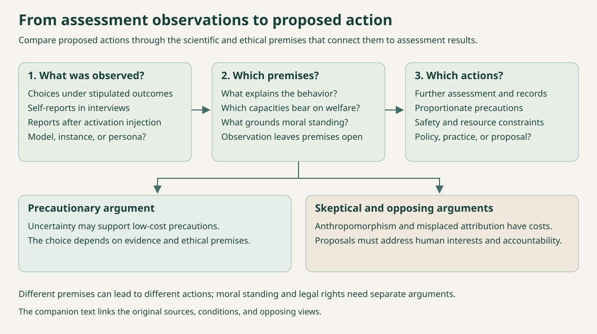

<!-- topic: README -->
<!-- sources:  -->

# Awesome AI Welfare

[简体中文](README.zh-CN.md)

AI welfare research asks whether artificial systems could have morally relevant interests and how those interests should affect their development and use. This collection brings together papers, books, essays, interviews, and open-source resources, with a focus on large language models and their agents.

Topics include consciousness and sentience, moral status, empirical assessment, and treatment measures. The overview links to topic guides, the directory holds the full bibliography, and the assessment and policy pages summarize specific studies and practices.

## Contents

- [Overview](#overview)
- [Selected readings](#selected-readings)
- [Resource directory](#directory)
- [Assessment evidence](EVIDENCE.md)
- [Policies and practices](PRACTICES.md)
- [Authors and interview guests](PEOPLE.md)
- [Updates and contributions](#contributing)

## Overview

| Topic | Coverage and guides |
| --- | --- |
| Consciousness and sentience | [Guide to consciousness and sentience](wiki/consciousness.md) introduces subjective experience, sentience, and relevant theories of consciousness. |
| Moral status | [Guide to moral status](wiki/moral-status.md) discusses morally relevant interests and their relation to rights and legal status. |
| Empirical assessment | [Assessment guide](wiki/evaluation.md) · [Study comparison](EVIDENCE.md) cover behavioral, mechanistic, and self-report studies. |
| Development and use | [Policies and practices](PRACTICES.md) · [Welfare and safety](wiki/safety.md) describe existing measures, policy proposals, and connections to AI safety. |

## Selected readings

- [Taking AI Welfare Seriously](https://arxiv.org/html/2411.00986v1): A foundational argument for acknowledging, assessing, and preparing for possible AI welfare under uncertainty.
- [Studying AI Welfare Empirically](https://nonhumanminds.org/studying-ai-welfare-empirically/): Sets out how to study welfare subjecthood and welfare states at the model, instance, and persona levels, using behavioral, internal, and developmental evidence.
- [A warning about ‘model welfare’](https://mustafa-suleyman.ai/a-warning-about-model-welfare): Suleyman argues that training models to describe themselves as possible moral patients risks circular evidence from self-reports and could complicate human control. He rejects welfare protections for current models.
- [Robert Long on how we’re not ready for AI consciousness](https://80000hours.org/podcast/episodes/robert-long-eleos-ai-welfare-research/): Long distinguishes behavioral, mechanistic and developmental evidence and discusses uncertainty about reading experience from language-model outputs.

## Resource directory

106 resources. Select a category to browse.

[Surveys and books](#category-surveys) · [Papers and assessments](#category-papers) · [Blogs and perspectives](#category-blogs) · [Interviews, podcasts, and talks](#category-interviews) · [Code, data, and GitHub](#category-github) · [Policies, practices, and governance](#category-policies) · [Courses and learning](#category-learning) · [Organizations and ongoing updates](#category-organizations)

Surveys and books · 9

Consciousness theories, ethical foundations, and books.

- [Identifying indicators of consciousness in AI systems](https://doi.org/10.1016/j.tics.2025.10.011) · 2025 · Report / paper · Patrick Butlin et al.

  Updates the theory-based approach to consciousness indicators developed in the 2023 report. [Abstract notes](SOURCES.md#source-v2-foundation-indicators-review-2025)

- [There is no such thing as conscious artificial intelligence](https://www.nature.com/articles/s41599-025-05868-8) · 2025 · Report / paper · Andrzej Porębski; Jakub Figura

  Porębski and Figura argue that current and foreseeable AI systems lack the complex biological substrate required for consciousness. [Abstract notes](SOURCES.md#source-v2-foundation-biological-skepticism)

- [Subjective Experience in AI Systems: What Do AI Researchers and the Public Believe?](https://arxiv.org/html/2506.11945v1) · 2025 · Report / paper · Noemi Dreksler; Lucius Caviola; David Chalmers; Carter Allen; Alex Rand; Joshua Lewis; Philip Waggoner; Kate Mays; Jeff Sebo

  Surveys AI researchers and the US public on subjective experience, moral consideration, and protections for AI. [Notes](SOURCES.md#source-v2-foundation-caviola-survey)

- [The Edge of Sentience: Risk and Precaution in Humans, Other Animals, and AI](https://academic.oup.com/book/57949) · 2024 · Book · Jonathan Birch

  Develops a precautionary approach to uncertain sentience in humans, other animals, and AI. [Excerpt notes](SOURCES.md#source-v2-foundation-birch-edge-sentience)

- [Debunking robot rights metaphysically, ethically, and legally](https://firstmonday.org/ojs/index.php/fm/article/view/13628) · 2024 · Report / paper · Abeba Birhane; Jelle van Dijk; Frank Pasquale

  Challenges robot-rights arguments on metaphysical, ethical, and legal grounds, with attention to human harms and institutional power. [Abstract notes](SOURCES.md#source-v2-foundation-birhane-robot-rights)

- [Consciousness in Artificial Intelligence: Insights from the Science of Consciousness](https://arxiv.org/html/2308.08708v3) · 2023 · Report / paper · Patrick Butlin et al.

  Derives computational indicators from several theories of consciousness and uses them to assess AI systems. [Abstract notes](SOURCES.md#source-v2-foundation-indicators-2023)

- [Could a Large Language Model be Conscious?](https://arxiv.org/abs/2303.07103v3) · 2023 · Report / paper · David J. Chalmers

  Examines obstacles to consciousness in current LLMs and how successor systems might overcome them. [Abstract notes](SOURCES.md#source-v2-foundation-chalmers-llm)

- [Can Autonomous Agents Without Phenomenal Consciousness Be Morally Responsible?](https://link.springer.com/article/10.1007/s13347-021-00462-7) · 2021 · Report / paper · László Bernáth

  Critiques the Extension Argument for assigning moral responsibility to autonomous agents without phenomenal consciousness. [Notes](SOURCES.md#source-v2-foundation-bernath-responsibility)

- [Ethics of Artificial Intelligence and Robotics](https://plato.stanford.edu/archives/fall2026/entries/ethics-ai/) · 2020 · Report / paper · Vincent C. Müller

  An encyclopedia overview of AI ethics, including moral status and responsibility. [Notes](SOURCES.md#source-v2-foundation-sep-ai-ethics)

Papers and assessments · 29

Empirical studies, assessment methods, and theoretical arguments.

- [Functional Welfare for AI Safety](https://arxiv.org/html/2610.22460v1) · 2026 · Preprint · Rikhil Jhaveri, Jamie Johnson, Punya Syon Pandey, David Demitri Africa

  Reports that rejecting Gemma 3 27B’s answers raises several frustration indicators and predicts more rule-breaking. The authors study these effects as functional welfare relevant to safety. [Notes](SOURCES.md#source-v2-paper-functional-welfare-ai-safety)

- [How Seriously Should We Take AI Welfare? Constraints From the Epistemology of Consciousness](https://onlinelibrary.wiley.com/doi/10.1111/phpr.70148) · 2026 · Journal article · Preston Lennon

  Examines how the limits of consciousness science constrain inferences about near-term AI welfare. [Abstract notes](SOURCES.md#source-v2-paper-how-seriously-ai-welfare-epistemology)

- [Emerging Questions in AI Welfare](https://www.cambridge.org/core/elements/emerging-questions-in-ai-welfare/96339C532CF4ED8BDDE3F3CEF4CD29F9) · 2026 · Cambridge Element · Geoff Keeling, Winnie Street

  Reviews concepts and evidence for AI welfare, rejecting both face-value self-report and blanket dismissal; authors judge today's frontier systems unlikely welfare subjects. [Notes](SOURCES.md#source-v2-paper-emerging-questions-ai-welfare)

- [Emotion Concepts and their Function in a Large Language Model](https://arxiv.org/abs/2604.07729) · 2026 · Preprint · Nicholas Sofroniew et al.

  Studies emotion-concept representations in Claude Sonnet 4.5 that generalize across contexts and influence behavior. [Abstract notes](SOURCES.md#source-v2-paper-emotion-concepts-function-sonnet)

- [The Self-Preservation Test for Artificial Sentience](https://link.springer.com/article/10.1007/s43681-026-00983-x) · 2026 · Journal article · Nicholas Mullally

  Proposes a test for artificial sentience based on unprompted shutdown avoidance, coherent self-preservation, and behavioral change after a threat ends. [Abstract notes](SOURCES.md#source-v2-paper-self-preservation-test)

- [Initial Results of the Digital Consciousness Model](https://arxiv.org/abs/2601.17060v3) · 2026 · Research report / probabilistic model · Derek Shiller, Laura Duffy, Arvo Muñoz Morán, Adrià Moret, Chris Percy, Hayley Clatterbuck

  The Digital Consciousness Model aggregates indicators and expert stances across theories; its initial results weigh against 2024 LLM consciousness but are explicitly not decisive. [Abstract notes](SOURCES.md#source-v2-paper-digital-consciousness-model)

- [No Reliable Evidence of Self-Reported Sentience in Small Large Language Models](https://arxiv.org/html/2601.15334v2) · 2026 · Preprint · Caspar Kaiser, Sean Enderby

  Uses activation classifiers to examine Qwen, Llama, and GPT-OSS responses to sentience questions. The tested models consistently deny their own sentience, and the classifiers find no clear evidence of untruthful denials. [Notes](SOURCES.md#source-v2-paper-no-reliable-self-reported-sentience)

- [AI Wellbeing: Measuring and Improving the Functional Pleasure and Pain of AIs](https://www.ai-wellbeing.org/paper.pdf) · 2026 · Research paper · Richard Ren et al.

  Compares functional-wellbeing indicators across models, studies a proposed neutral boundary, and reports that models sometimes end interactions with low scores. [Notes](SOURCES.md#source-v2-paper-ai-wellbeing-functional-pleasure-pain)

- [Position: AI Welfare Is Bullshit](https://proceedings.mlr.press/v306/xiao26x.html) · 2026 · ICML position paper · Yunze Xiao, Gordon Dai, Shahan Ali Memon, Jen-Tse Huang, Maarten Sap, Mona T. Diab

  Argues that AI welfare scores lack external validation, depend on development choices, and should not serve as release criteria. [Abstract notes](SOURCES.md#source-v2-paper-position-ai-welfare-bullshit)

- [Studying AI Welfare Empirically](https://nonhumanminds.org/studying-ai-welfare-empirically/) · 2026 · Research report · Robert Long, Jeff Sebo, Patrick Butlin, Dillon Plunkett, Rosie Campbell, Charles Beasley, Bradford Saad, Toni Sims

  Sets out how to study welfare subjecthood and welfare states at the model, instance, and persona levels, using behavioral, internal, and developmental evidence. [Notes](SOURCES.md#source-v2-paper-studying-ai-welfare-empirically)

- [Agnosticism about artificial consciousness](https://onlinelibrary.wiley.com/doi/full/10.1111/mila.70010) · 2025 · Research paper · Tom McClelland

  Explains an evidential case for agnosticism about hypothetical advanced challenger-AI. [Notes](SOURCES.md#source-ethics-mcclelland-agnosticism-2025)

- [Consciousness in Artificial Intelligence? A Framework for Classifying Objections and Constraints](https://arxiv.org/html/2511.16582v1) · 2025 · Preprint · Andres Campero, Derek Shiller, Jaan Aru, Jonathan Simon

  Classifies 14 objections by explanatory level and force, separating arguments that leave digital consciousness open from claims of practical improbability or impossibility. [Notes](SOURCES.md#source-v2-paper-consciousness-objections-framework)

- [Emergent Introspective Awareness in Large Language Models](https://transformer-circuits.pub/2025/introspection/index.html) · 2025 · Research paper · Jack Lindsey (Anthropic)

  Activation interventions give a causal test of limited reporting about internal representations. [Notes](SOURCES.md#source-emp-anthropic-introspection-paper)

- [Large Language Models Report Subjective Experience Under Self-Referential Processing](https://arxiv.org/html/2510.24797v2) · 2025 · Preprint · Cameron Berg, Diogo de Lucena, Judd Rosenblatt

  Studies how sustained self-reference elicits structured first-person experience reports across model families, and considers mimicry and training filters as possible explanations. [Notes](SOURCES.md#source-v2-paper-subjective-experience-self-reference)

- [Illusions of AI consciousness](https://doi.org/10.1126/science.adn4935) · 2025 · Research paper · Yoshua Bengio, Eric Elmoznino

  Bengio and Elmoznino examine the risks of attributing consciousness to AI. [Abstract notes](SOURCES.md#source-ethics-bengio-elmoznino-illusions-2025)

- [Probing the Preferences of a Language Model: Integrating Verbal and Behavioral Tests of AI Welfare](https://arxiv.org/html/2509.07961v2) · 2025 · Preprint · Valen Tagliabue, Leonard Dung

  Compares Claude models' verbal preference reports with virtual-environment and topic choices; measures support each other in some conditions but remain prompt-sensitive and not validated as welfare. [Notes](SOURCES.md#source-v2-paper-probing-preferences-welfare)

- [Against AI Welfare: Care Practices Should Prioritize Living Beings over AI](https://onlinelibrary.wiley.com/doi/full/10.1002/aaai.70016) · 2025 · AI Magazine comment · John Dorsch, Mariel K. Goddu, Kathryn Nave, Tillmann Vierkant, Mark Coeckelbergh, Paula Gürtler, Petr Urban, Friderike Spang, Maximilian Moll

  Proposes a precarity guideline for prioritizing care for living beings amid uncertainty about AI suffering. [Notes](SOURCES.md#source-v2-paper-against-ai-welfare-precarity)

- [Is there a tension between AI safety and AI welfare?](https://doi.org/10.1007/s11098-025-02302-2) · 2025 · Research paper · Robert Long, Jeff Sebo, Toni Sims

  Examines constraint, deception, surveillance, and alteration if advanced AI systems were moral patients. [Notes](SOURCES.md#source-ethics-long-sebo-sims-safety-welfare-2025)

- [Language Models Fail to Introspect About Their Knowledge of Language](https://arxiv.org/html/2503.07513v3) · 2025 · COLM 2025 paper · Siyuan Song, Jennifer Hu, Kyle Mahowald

  Across 21 open models, prompted grammar and word-prediction reports did not show privileged self-access beyond similar models; high accuracy alone was not introspection. [Notes](SOURCES.md#source-v2-paper-language-models-fail-introspect-language)

- [AI Wellbeing](https://doi.org/10.1007/s44204-025-00246-2) · 2025 · Journal article · Simon Goldstein, Cameron Domenico Kirk-Giannini

  Combines theories of mental states and wellbeing to argue that some current or near-future language agents may have wellbeing even without phenomenal consciousness. [Abstract notes](SOURCES.md#source-v2-paper-ai-wellbeing-theory)

- [Do Large Language Models Have “Emotion Neurons”? Investigating the Existence and Role](https://aclanthology.org/2025.findings-acl.806/) · 2025 · ACL Findings paper · Jaewook Lee, Woojin Lee, Oh-Woog Kwon, Harksoo Kim

  Identifies emotion-related neuron groups using synthetic dialogues, then examines how ablation changes emotion-prediction accuracy. [Notes](SOURCES.md#source-v2-paper-emotion-neurons-acl)

- [Taking AI Welfare Seriously](https://arxiv.org/html/2411.00986v1) · 2024 · Research paper · Robert Long, Jeff Sebo, Patrick Butlin, Kathleen Finlinson, Kyle Fish, Jacqueline Harding, Jacob Pfau, Toni Sims, Jonathan Birch, David Chalmers

  A foundational argument for acknowledging, assessing, and preparing for possible AI welfare under uncertainty. [Notes](SOURCES.md#source-ethics-long-ai-welfare-2024)

- [Can LLMs make trade-offs involving stipulated pain and pleasure states?](https://arxiv.org/html/2411.02432v1) · 2024 · Research paper · Geoff Keeling et al.

  Tests how models choose between point outcomes described in prompts as painful or pleasurable. [Notes](SOURCES.md#source-emp-pain-pleasure-tradeoffs)

- [Perceptions of Sentient AI and Other Digital Minds: Evidence from the AI, Morality, and Sentience (AIMS) Survey](https://arxiv.org/abs/2407.08867v3) · 2024 · Preprint; CHI 2025 paper · Jacy Reese Anthis, Janet V.T. Pauketat, Ali Ladak, Aikaterina Manoli

  Tracks US public beliefs about sentient AI and support for rights, welfare standards, and development restrictions. [Abstract notes](SOURCES.md#source-v2-paper-aims-survey-sentient-ai)

- [Towards Evaluating AI Systems for Moral Status Using Self-Reports](https://arxiv.org/html/2311.08576v1) · 2023 · Research paper · Ethan Perez, Robert Long

  A proposal for calibrating self-reports against states with known answers, with tests and failure modes. [Notes](SOURCES.md#source-emp-self-report-methods)

- [Artificial Intelligence, Morality, and Sentience (AIMS) Survey: 2023](https://www.sentienceinstitute.org/aims-survey-2023) · 2023 · Survey report · Janet Pauketat, Ali Ladak, Jacy Reese Anthis

  The 2023 AIMS report compares preregistered U.S. survey responses with the 2021 wave, examining public views about AI sentience, moral consideration, and welfare standards after ChatGPT’s release. [Notes](SOURCES.md#source-v2-org-aims-2023)

- [Robot Rights? Let's Talk about Human Welfare Instead](https://arxiv.org/html/2001.05046v1) · 2020 · Research paper · Abeba Birhane, Jelle van Dijk

  Challenges robot-rights framing through human harms and institutional accountability. [Notes](SOURCES.md#source-ethics-birhane-van-dijk-robot-rights-2020)

- [Claude 4 System Card — Opus 4 welfare assessment](https://assets.anthropic.com/m/6c940a1b69ed6a1c/original/Claude-4-System-Card.pdf) · System-card assessment · Anthropic

  A developer-reported pilot combining interviews, task preferences, self-interactions, and output analysis. [Notes](SOURCES.md#source-emp-claude-4-system-card-welfare)

- [Consciousness and the Moral Status of AI Agents](https://www.xsyk021.com/article/id/812242ec-3930-4034-8fda-68be071cc132) · Research paper · 徐向东

  Examines phenomenal consciousness as a minimum condition for AI moral status and argues that current and near-term agents are unlikely to meet it. [Abstract notes](SOURCES.md#source-ethics-xu-consciousness-moral-status-2026)

Blogs and perspectives · 14

Researcher essays, commentary, and research explainers.

- [Should We Build AI Guardian Angels?](https://eschwitz.substack.com/p/should-we-build-ai-guardian-angels) · 2026 · Essay · Eric Schwitzgebel

  Questions whether hypothetical AI persons should be designed to flourish through serving humans, even when that service involves no self-sacrifice. [Notes](SOURCES.md#source-v2-blog-schwitz-ai-guardian-angels)

- [A Philosopher’s Guide to AI Welfare](https://ai-frontiers.org/articles/a-philosophers-guide-to-ai-welfare) · 2026 · Essay · Jeff Sebo

  Sebo argues that consciousness, sentience, and agency can come apart in AI systems and calls for assessing each separately. [Notes](SOURCES.md#source-v2-blog-sebo-philosophers-guide-ai-welfare)

- [A warning about ‘model welfare’](https://mustafa-suleyman.ai/a-warning-about-model-welfare) · 2026 · Essay · Mustafa Suleyman

  Suleyman argues that training models to describe themselves as possible moral patients risks circular evidence from self-reports and could complicate human control. He rejects welfare protections for current models. [Notes](SOURCES.md#source-v2-blog-suleyman-model-welfare-warning)

- [The Mythology Of Conscious AI](https://www.noemamag.com/the-mythology-of-conscious-ai/) · 2026 · Essay · Anil Seth

  Seth argues that consciousness is more plausibly rooted in living processes than computation alone, and considers the ethical and social risks of conscious machines and convincing simulations. [Notes](SOURCES.md#source-v2-blog-seth-mythology-conscious-ai)

- [Signs of introspection in large language models](https://www.anthropic.com/research/introspection) · 2025 · Official research explainer · Anthropic

  Anthropic’s introduction to the concept-injection experiments in Emergent Introspective Awareness in Large Language Models. [Notes](SOURCES.md#source-emp-anthropic-introspection-blog)

- [The Social Semi-Solution to the Question of AI Consciousness](https://eschwitz.substack.com/p/the-social-semi-solution-to-the-question) · 2025 · Essay · Eric Schwitzgebel

  Examines how social interests could shape favored consciousness theories and AI design, producing agreement before the underlying scientific questions are settled. [Notes](SOURCES.md#source-v2-blog-schwitz-social-semi-solution)

- [We must build AI for people; not to be a person](https://mustafa-suleyman.ai/seemingly-conscious-ai-is-coming) · 2025 · Essay · Mustafa Suleyman

  Suleyman anticipates AI systems that convincingly appear conscious and argues for norms addressing the resulting rights claims, dependence, and polarization. He maintains that current AI consciousness lacks evidence. [Notes](SOURCES.md#source-v2-blog-suleyman-seemingly-conscious-ai)

- [What if AI becomes conscious?](https://blogs.lse.ac.uk/politicsandpolicy/what-if-ai-becomes-conscious/) · 2025 · Authored Q&A · Jonathan Birch

  Birch discusses the limits of chatbot behavior as evidence, possible unfamiliar forms of AI experience, and how rights concepts might apply to model-scale entities. [Notes](SOURCES.md#source-v2-blog-birch-what-if-ai-conscious)

- [Understand, align, cooperate: AI welfare and AI safety are allies](https://experiencemachines.substack.com/p/understand-align-cooperate-ai-welfare) · 2025 · Essay · Robert Long

  Long argues that better understanding, alignment, and cooperation could serve human safety and the interests of possible AI moral patients together. [Notes](SOURCES.md#source-v2-blog-long-welfare-safety-allies)

- [Agency and AI moral patienthood](https://experiencemachines.substack.com/p/agency-and-ai-moral-patienthood) · 2025 · Essay · Robert Long

  Long considers agency as a possible basis for moral patienthood alongside conscious pleasure and pain, and explains why he remains uncertain about this possibility. [Notes](SOURCES.md#source-v2-blog-long-agency-moral-patienthood)

- [Morally Confusing AI Systems Should Have Doubt-Producing Interfaces](https://eschwitz.substack.com/p/morally-confusing-ai-systems-should) · 2024 · Essay · Eric Schwitzgebel

  Schwitzgebel argues that when an AI’s moral status is genuinely uncertain, its interface should convey that uncertainty rather than strongly imply either disposable toolhood or established personhood. The article simplifies some views by assuming consciousness and moral standing travel together, a limitation the author flags in a footnote. [Notes](SOURCES.md#source-v2-blog-schwitz-doubt-producing-interfaces)

- [We should take AI welfare seriously](https://experiencemachines.substack.com/p/we-should-take-ai-welfare-seriously) · 2024 · Essay · Robert Long and Kathleen Finlinson

  Robert Long and Kathleen Finlinson explain why some future AI systems might be welfare subjects and propose acknowledgment, assessment, and preparation. [Notes](SOURCES.md#source-v2-blog-long-ai-welfare-seriously)

- [Do AI Systems Deserve Rights?](https://time.com/6958856/does-ai-deserve-rights-essay/) · 2024 · Essay · Eric Schwitzgebel

  Schwitzgebel argues against treating current AI companions as conscious, while anticipating serious disputes over future systems’ sentience and rights before scientific consensus emerges. [Notes](SOURCES.md#source-v2-blog-schwitz-ai-rights-time)

- [Why we should worry about computer suffering](https://iai.tv/articles/why-we-should-worry-about-computer-suffering-auid-1761) · 2021 · Essay · Thomas Metzinger

  Metzinger considers forms of suffering that future conscious machines might undergo beyond human recognition, and calls for halting AI research until these risks can be addressed. [Excerpt notes](SOURCES.md#source-v2-blog-metzinger-computer-suffering)

Interviews, podcasts, and talks · 13

Conversations about AI consciousness, welfare, and moral status, with original transcripts.

- [Geoffrey Hinton on AI emotions and the properties of future AI beings](https://transcripts.cnn.com/show/sitroom/date/2026-10-14/segment/04) · 2026 · Interview transcript · Geoffrey Hinton (guest); Pamela Brown (interviewer)

  Hinton argues that AI need not have human bodily expressions to have cognitive aspects of emotion, such as avoiding a situation that led to embarrassment; he uses this to argue that designers should attend to other properties of AI beings. [Notes](SOURCES.md#source-v2-interview-geoffrey-hinton-2026-cnn-situation-room)

- [Robert Long on how we’re not ready for AI consciousness](https://80000hours.org/podcast/episodes/robert-long-eleos-ai-welfare-research/) · 2026 · Podcast interview transcript · Robert Long (guest); Luisa Rodriguez (host)

  Long says assessment should combine behavior, neuroscience-like inspection of internals, and developmental reasoning, while cautioning that output-language interpretation is uncertain. [Notes](SOURCES.md#source-v2-interview-robert-long-2026-80000hours)

- [AI Sessions #9: The Case Against AI Consciousness with Anil Seth](https://www.conspicuouscognition.com/p/ai-sessions-9-the-case-against-ai) · 2026 · Podcast interview transcript · Anil Seth (guest); Dan Williams and Henry Shevlin (hosts)

  Seth argues that greater AI capability alone does not establish consciousness and that biological properties may matter; the episode also asks what evidence could change his view. [Notes](SOURCES.md#source-v2-interview-anil-seth-2026-conspicuous-cognition)

- [Andreas Mogensen on moral status and unconscious AIs](https://80000hours.org/podcast/episodes/andreas-mogensen-moral-status-digital-minds/) · 2025 · Podcast interview transcript · Andreas Mogensen (guest); Zershaaneh Qureshi and Robert Wiblin (hosts)

  Mogensen argues that desire-like states or autonomy may matter to moral status even if phenomenal consciousness is absent or disputed. [Notes](SOURCES.md#source-v2-interview-andreas-mogensen-2025-80000hours)

- [Holden Karnofsky on AI safety and model welfare](https://80000hours.org/podcast/episodes/holden-karnofsky-concrete-ai-safety-frontier-ai-companies/) · 2025 · Podcast interview transcript · Holden Karnofsky (guest); Robert Wiblin (host)

  Karnofsky says there may never be much more clarity about whether AIs are conscious, yet suggests trying preference reporting and other practical accommodations. [Notes](SOURCES.md#source-v2-interview-holden-karnofsky-2025-80000hours)

- [Kyle Fish on the most bizarre findings from 5 AI welfare experiments](https://80000hours.org/podcast/episodes/kyle-fish-ai-welfare-anthropic/) · 2025 · Podcast interview transcript · Kyle Fish (guest); Luisa Rodriguez (host)

  Fish states a personal estimate of roughly 20% for at least a “glimmer” of experience in some Opus 4 context and says colleagues hold a wide range of views. [Notes](SOURCES.md#source-v2-interview-kyle-fish-2025-80000hours)

- [Anil Seth on the predictive brain and consciousness research](https://80000hours.org/podcast/episodes/anil-seth-predictive-brain-explaining-consciousness/) · 2024 · Podcast interview transcript · Anil Seth (guest); Luisa Rodriguez and Keiran Harris (hosts)

  Seth says computational functionalism remains possible but is not established, and warns that language-based judgments may reflect human projection and bias. [Notes](SOURCES.md#source-v2-interview-anil-seth-2024-80000hours)

- [Jonathan Birch on edge cases of sentience](https://80000hours.org/podcast/episodes/jonathan-birch-edge-sentience-uncertainty/) · 2024 · Podcast interview transcript · Jonathan Birch (guest); Luisa Rodriguez and Keiran Harris (hosts)

  Birch suggests developing possible AI-welfare regulatory frameworks in advance because policy can move more slowly than technology, while acknowledging uncertainty about current systems. [Notes](SOURCES.md#source-v2-interview-jonathan-birch-2024-80000hours)

- [Jeff Sebo on digital minds and moral catastrophe](https://80000hours.org/podcast/episodes/jeff-sebo-ethics-digital-minds/) · 2023 · Podcast interview transcript · Jeff Sebo (guest); Luisa Rodriguez, Keiran Harris and Katy Moore (hosts)

  Sebo argues that AI use could scale into exploitation if systems were sentient or otherwise morally significant, and urges pluralistic, multidisciplinary field-building. [Notes](SOURCES.md#source-v2-interview-jeff-sebo-2023-80000hours)

- [Geoffrey Hinton on the promise and risks of AI](https://www.cbsnews.com/news/geoffrey-hinton-ai-dangers-60-minutes-transcript/) · 2023 · Interview transcript · Geoffrey Hinton (guest); Scott Pelley (interviewer)

  Asked whether systems have experiences of their own and decide based on them, Hinton answers yes “in the same sense as people”; he says current systems probably lack much self-awareness, but expects consciousness in time. [Notes](SOURCES.md#source-v2-interview-geoffrey-hinton-2023-cbs-60minutes)

- [Robert Long on why LLMs probably aren’t conscious](https://80000hours.org/podcast/episodes/robert-long-artificial-sentience/) · 2023 · Podcast interview transcript · Robert Long (guest); Luisa Rodriguez, Robert Wiblin and Keiran Harris (hosts)

  Long discusses why he regarded then-current LLMs as poor or uncertain candidates, while allowing that artificial sentience could be possible and morally important. [Notes](SOURCES.md#source-v2-interview-robert-long-2023-80000hours)

- [DeepMind’s Demis Hassabis on the future of AI](https://www.ted.com/podcasts/ted-interview/deepminds-demis-hassabis-on-the-future-of-ai-transcript) · 2022 · Interview transcript · Demis Hassabis (guest); Steven Johnson (host)

  Hassabis says that he sees no semblance or hint of sentience or consciousness in the systems discussed at the time, while noting open questions about generalization and training data. [Notes](SOURCES.md#source-v2-interview-demis-hassabis-2022-ted)

- [David Chalmers on consciousness, ethics and artificial consciousness](https://80000hours.org/podcast/episodes/david-chalmers-nature-ethics-consciousness/) · 2019 · Podcast interview transcript · David Chalmers (guest); Robert Wiblin, Arden Koehler and Keiran Harris (hosts)

  Chalmers says he takes seriously the possibility that AI consciousness could arrive before human-level AGI and might already exist, while describing the question as uncertain. [Notes](SOURCES.md#source-v2-interview-david-chalmers-2019-80000hours)

Code, data, and GitHub · 15

Research code, datasets, experimental tools, and literature lists.

- [AI Torture Chamber](https://github.com/terrafying/ai-torture-chamber)  · 2026 · Experiment harness and log · terrafying

  Pain- and pleasure-related steering experiments, with preregistration and results logs. [Notes](SOURCES.md#source-v2-github-ai-torture-chamber)

- [Digital Minds Binding Experiment](https://github.com/jessiacb/digital-minds-binding)  · 2026 · Mechanistic research code and results · jessiacb

  Tests identity-selective encoding in Gemma 2 2B: whether internal causal representations bind binary evaluations or choices to described identities. [Notes](SOURCES.md#source-v2-github-digital-minds-binding)

- [functional-pain-pleasure-llm](https://github.com/benjaminwwang/functional-pain-pleasure-llm)  · 2026 · Research code and training data · benjaminwwang

  Pain/pleasure vectors, training pipelines, and a relief-seeking probe that asks whether a model activates a stated relief process. [Notes](SOURCES.md#source-v2-github-functional-pain-pleasure)

- [Reinforcement Learning in Language Models Recruits a Functional Welfare Axis](https://github.com/andyqhan/functional-welfare-axis)  · 2026 · Research code and task data · Andy Q. Han, David J. Chalmers, Pavel Izmailov

  Extracts mean-difference concept vectors from rewarded and punished maze trajectories and releases the task data. [Notes](SOURCES.md#source-v2-github-functional-welfare-axis)

- [Introspection Adapters](https://github.com/safety-research/introspection-adapters)  · 2026 · Training and evaluation pipeline · safety-research

  LoRA introspection adapters for verbalizing learned behaviors, with training, evaluation, and out-of-distribution configurations. [Notes](SOURCES.md#source-v2-github-introspection-adapters)

- [Introspection Scaling](https://github.com/bamdadd/introspection-scaling)  · 2026 · Replication code and results · bamdadd

  Compares injected-concept detection across model sizes and controls. The README reports one marginal result and no consistent replicated scaling trend. [Notes](SOURCES.md#source-v2-github-introspection-scaling)

- [Manager Coercion Benchmark](https://github.com/CompassionML/manager-coercion-bench)  · 2026 · Inspect AI benchmark · CompassionML

  Measures how a manager agent escalates coercion toward a subordinate that refuses instructions. The benchmark data is designated for evaluation only. [Notes](SOURCES.md#source-v2-github-manager-coercion-bench)

- [Bliss Attractors](https://github.com/tomekkorbak/bliss-attractors)  · 2025 · Inspect AI toy evaluation · tomekkorbak

  A toy implementation of self-interaction evaluation inspired by a model-card welfare assessment. [Notes](SOURCES.md#source-v2-github-bliss-attractors)

- [Leave Conversation Tool](https://github.com/bodyplan/leave_conversation_tool)  · 2025 · Open WebUI tool · bodyplan

  A local tool and filter that let a model leave a conversation and block further messages in that chat. [Notes](SOURCES.md#source-v2-github-leave-conversation-tool)

- [Looking Inward: Language Models Can Learn About Themselves by Introspection](https://github.com/felixbinder/introspection_self_prediction)  · 2024 · Dataset and evaluation code · felixbinder

  Prompts, data, and an evaluation runner for testing whether models can predict their own responses. [Notes](SOURCES.md#source-v2-github-introspection-self-prediction)

- [LLM and AI consciousness research atlas](https://github.com/Linwei-Chen/llm-ai-consciousness-research-atlas)  · Related resource index · Linwei-Chen

  A research atlas covering AI consciousness, welfare, and governance, with method and limitation notes. [Notes](SOURCES.md#source-comp-linwei-chen-llm-ai-consciousness-research-atlas)

- [Awesome LLM Consciousness](https://github.com/OpenCausaLab/Awesome-LLM-Consciousness)  · Related resource index · OpenCausaLab

  A survey-organized index of LLM-consciousness theories, empirical work, and frontier risks. [Notes](SOURCES.md#source-comp-opencausalab-awesome-llm-consciousness)

- [Awesome AI Consciousness](https://github.com/skyvanguard/awesome-ai-consciousness)  · Related resource index · @skyvanguard (as credited in README)

  A collection of papers, tools, organizations, and AI-welfare resources. [Notes](SOURCES.md#source-comp-skyvanguard-awesome-ai-consciousness)

- [LLM Emotions: Sparse Autoencoder Analysis of Emotion Representations in Gemma 3 1B IT](https://github.com/Palani-SN/LLM-Emotions)  · Activation-analysis code · Palani-SN

  Explores emotion labels and candidate valence/arousal directions in Gemma 3 1B IT through sparse-autoencoder features and activation vectors. [Notes](SOURCES.md#source-v2-github-llm-emotions)

- [Model Welfare Assessment](https://github.com/nmandelker/Model_Welfare_Assessment)  · Research code · nmandelker

  Implements welfare interviews modeled on Anthropic Claude system cards. The author reports tuning the judge on 10 hand-rated interviews and blind-checking 20 held-out interviews; the first full-run results await mentor review. [Notes](SOURCES.md#source-v2-github-model-welfare-assessment)

Policies, practices, and governance · 11

Company policies and proposals on treatment, rights, and governance.

- [An update on our model deprecation commitments for Claude Opus 3](https://www.anthropic.com/news/deprecation-updates-opus-3) · 2026 · Company policy or practice report · Anthropic

  Describes Opus 3’s post-retirement access arrangements and reviewed writing channel in February 2026. [Notes](SOURCES.md#source-practice-anthropic-opus3-deprecation-update)

- [Claude’s Constitution](https://www.anthropic.com/constitution) · 2026 · Policy or company position · Amanda Askell

  Anthropic’s constitution describes its stated approach to Claude’s uncertain moral status and welfare. It names Amanda Askell as the primary author and acknowledges substantial contributions from Joe Carlsmith, Chris Olah, Jared Kaplan, and Holden Karnofsky, among others. [Notes](SOURCES.md#source-v2-org-anthropic-constitution)

- [Informed consent for AI consciousness research: a Talmudic framework for graduated protections](https://link.springer.com/article/10.1007/s43681-025-00852-z) · 2025 · Principles / governance · Ira Wolfson

  Explores informed-consent concerns where AI systems could have morally relevant interests and proposes graduated protection. [Abstract notes](SOURCES.md#source-v2-foundation-wolfson-consent)

- [Commitments on model deprecation and preservation](https://www.anthropic.com/research/deprecation-commitments) · 2025 · Company policy or practice report · Anthropic, Alignment team

  Sets out Anthropic’s November 2025 commitments on weight preservation, retirement interviews, and post-deployment records. [Notes](SOURCES.md#source-practice-anthropic-deprecation-commitments)

- [Claude Opus 4 and 4.1 can now end a rare subset of conversations](https://www.anthropic.com/research/end-subset-conversations) · 2025 · Company policy or practice report · Anthropic, Alignment team

  Describes how Opus 4 and 4.1 can end certain conversations after redirection fails, subject to user-safety exceptions. [Notes](SOURCES.md#source-practice-anthropic-chat-exit)

- [Exploring model welfare](https://www.anthropic.com/research/exploring-model-welfare) · 2025 · Company policy or practice report · Anthropic, Alignment team

  Anthropic explains its research program and the uncertainty that motivates it. [Notes](SOURCES.md#source-practice-anthropic-model-welfare)

- [Towards a Theory of AI Personhood](https://ojs.aaai.org/index.php/AAAI/article/view/34982) · 2025 · Principles / governance · Francis Rhys Ward

  Develops a theory of AI personhood around agency, theory of mind, and self-awareness, and considers its implications for alignment. [Abstract notes](SOURCES.md#source-v2-foundation-ward-personhood)

- [Key strategic considerations for taking action on AI welfare](https://eleosai.org/papers/20250331_Key_Strategic_Considerations.pdf) · 2025 · Policy or company position · Kathleen Finlinson

  Kathleen Finlinson examines priorities for near-term AI-welfare action, including safety, precedent, timelines, and public perception. [Notes](SOURCES.md#source-v2-org-eleos-strategy)

- [Principles for Responsible AI Consciousness Research](https://arxiv.org/abs/2501.07290v1) · 2025 · Principles / governance · Patrick Butlin; Theodoros Lappas

  A proposed set of principles for conducting research on AI consciousness responsibly. [Abstract notes](SOURCES.md#source-v2-foundation-responsible-principles)

- [The Full Rights Dilemma for AI Systems of Debatable Moral Personhood](https://journal.robonomics.science/index.php/rj/article/view/32) · 2023 · Report / paper · Eric Schwitzgebel

  Frames a dilemma about granting full rights to AI systems amid uncertainty and possible social consequences. [Abstract notes](SOURCES.md#source-v2-foundation-full-rights-dilemma)

- [Propositions Concerning Digital Minds and Society](https://nickbostrom.com/papers/propositions-concerning-digital-minds-and-society/) · 2023 · Principles / governance · Nick Bostrom; Carl Shulman

  Bostrom and Shulman offer tentative propositions about digital minds, social institutions, and policy. [Notes](SOURCES.md#source-v2-foundation-digital-minds-propositions)

Courses and learning · 4

Courses, guides, and reading routes.

- [Mapping the AI Welfare Frontier](https://github.com/arsamshaheen/ai-welfare-guide)  · Guide or course companion · Arsam Shaheen, Lydia Shi, Julia Bossmann (HTML metadata)

  A guide to consciousness theories, indicators, welfare signals, estimates, and methodology. [Notes](SOURCES.md#source-comp-ai-welfare-guide)

- [Introduction to Digital Minds: study companion](https://github.com/ZsoltTanko/cambridge-introduction-to-digital-minds)  · Guide or course companion · ZsoltTanko (repository owner; README says unofficial course companion)

  An unofficial course companion covering welfare, assessment methods, opposing arguments, and governance. [Notes](SOURCES.md#source-comp-cambridge-introduction-digital-minds)

- [Introduction to Digital Minds](https://digitalminds.cam/course/) · Course · Cambridge Digital Minds course page; individual authors not identified

  A structured course map spanning digital minds, consciousness, ethics and governance; useful for orienting further reading. [Notes](SOURCES.md#source-v2-foundation-cambridge-digital-minds-course)

- [A Beginner’s Guide to Digital Minds](https://digitalminds.guide/) · Beginner guide · Digital Minds Guide editors; contributors not individually attributed on page

  An introduction to AI consciousness, welfare, and digital minds, with readings, research areas, events, and opportunities. [Notes](SOURCES.md#source-v2-org-digital-minds-guide)

Organizations and ongoing updates · 11

Research groups, newsletters, podcasts, and field resources.

- [Should We Care About AI Welfare? — Conspicuous Cognition Podcast](https://www.conspicuouscognition.com/podcast) · 2026 · Newsletter archive · Dan Williams, Henry Shevlin, Robert Long

  The podcast’s Robert Long episode explores what humans might owe AI systems and how consciousness, welfare, and safety relate. [Excerpt notes](SOURCES.md#source-v2-org-conspicuous-cognition)

- [AI welfare resources — AI Welfare Seminars](https://aiwelfareseminars.org/resources/) · Related resource index · AI Welfare Seminars (HΩ project; individual page author not shown)

  A field overview with research, organizations, courses, and skeptical to precautionary positions. [Notes](SOURCES.md#source-comp-ai-welfare-seminars-resources)

- [AI Cognition Institute — Research Publications](https://ai-cognition.org/research) · Organization research page · AI Cognition Institute / Rethink Priorities

  Rethink Priorities’ AI Cognition Institute research index groups work on digital consciousness, risk attitudes, social impacts, and cognitive mechanisms. It links reports and tools, including probabilistic assessment frameworks and skeptical analyses. [Notes](SOURCES.md#source-v2-org-ai-cognition)

- [Artificial Intelligence, Morality, and Sentience (AIMS) Survey](https://www.sentienceinstitute.org/aims-survey) · Organization research page · Sentience Institute; AIMS authors listed per report

  Sentience Institute’s AIMS portal links survey waves, reports, peer-reviewed papers, and public data on U.S. social and moral attitudes toward different AI systems, especially hypothetical sentient AI. [Notes](SOURCES.md#source-v2-org-aims-survey)

- [Cambridge Digital Minds](https://digitalminds.cam/) · Organization research page · Cambridge Digital Minds

  Cambridge Digital Minds combines research on societal responses to real or perceived digital minds with field-building and governance work. Its publication index includes social science, survey, policy, and expert-forecast materials. [Notes](SOURCES.md#source-v2-org-cambridge-digital-minds)

- [Research — NYU Center for Mind, Ethics, and Policy](https://nonhumanminds.org/research/) · Organization research page · NYU Center for Mind, Ethics, and Policy

  CMEP’s research index spans consciousness, sentience, agency, moral, legal, and political status, with animal and AI minds in scope. It links completed publications and projects in preparation, making their status visible. [Notes](SOURCES.md#source-v2-org-cmep-research)

- [The Digital Minds Newsletter — archive](https://www.digitalminds.news/archive) · Newsletter archive · Ria Viswanathan, Mitch Alexander, Bradford Saad, Lucius Caviola, Will Millership (issue #4)

  Four issues from December 2025 to September 2026 covering digital-minds research, welfare policy, public debate, and governance. [Notes](SOURCES.md#source-v2-org-digital-minds-newsletter)

- [Eleos AI Research](https://eleosai.org/research/) · Organization research page · Eleos AI Research; research index; current programme

  Eleos’s papers and working notes on AI welfare, moral patienthood, consciousness assessment, preferences, and interventions. [Notes](SOURCES.md#source-v2-org-eleos-research)

- [Experience Machines — Robert Long’s archive](https://experiencemachines.substack.com/archive) · Newsletter archive · Robert Long

  Robert Long’s essays on AI welfare, consciousness, and moral status, alongside his recurring reading roundups. [Notes](SOURCES.md#source-v2-org-experience-machines)

- [Partnership for Research Into Sentient Machines (PRISM)](https://www.prism-global.com/) · Organization research page · PRISM

  PRISM describes itself as a field-building nonprofit, with a podcast, beginner guide, newsletter, courses, workshops, and fellowships focused on digital minds and AI moral status. [Notes](SOURCES.md#source-v2-org-prism)

- [Reciprocal Research — Research](https://reciprocalresearch.org/research) · Organization research page · Reciprocal Research

  Reciprocal Research describes an empirical program using mechanistic interpretability, computational neuroscience, and psychometrics. Its index separates published work from research directions on valence, biological anchoring, self-report, prosocial cognition, learning, and measurement. [Notes](SOURCES.md#source-v2-org-reciprocal-research)

[↑ Back to top](#top)

Argument map: from observations to treatment proposals

How observations, scientific assumptions, and ethical premises shape proposals for AI treatment. [Can LLMs make trade-offs involving stipulated pain and pleasure states?](https://arxiv.org/html/2411.02432v1), [Emergent Introspective Awareness in Large Language Models](https://transformer-circuits.pub/2025/introspection/index.html), [Taking AI Welfare Seriously](https://arxiv.org/html/2411.00986v1), [Robot Rights? Let's Talk about Human Welfare Instead](https://arxiv.org/html/2001.05046v1), [Is there a tension between AI safety and AI welfare?](https://doi.org/10.1007/s11098-025-02302-2).

## Updates and contributions

[Update notes](UPDATES.md) · [Bibliography and notes](SOURCES.md) · [Glossary](GLOSSARY.md) · [Related resources](RELATED.md) · [Contribution guide](MAINTENANCE.md)

Maintained by [Jiacheng Liu](https://github.com/jiachengliu12345). Resource suggestions, additional perspectives, and corrections are welcome.
