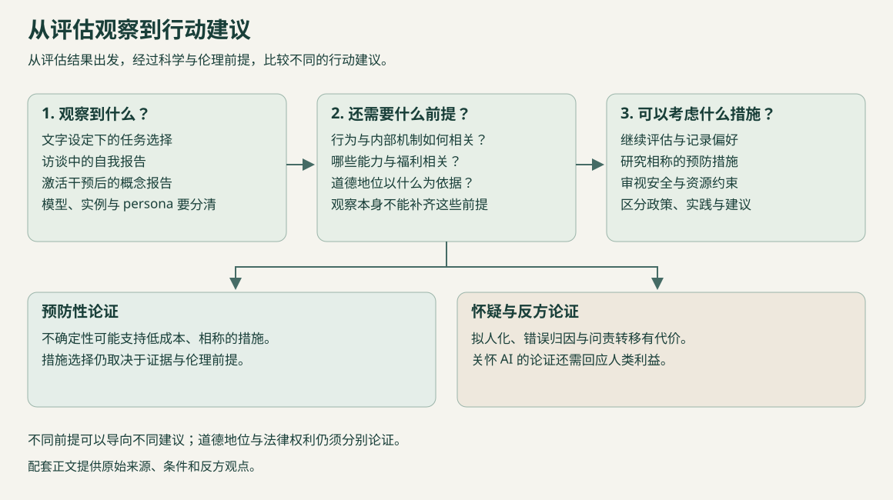

<!-- topic: README -->
<!-- sources:  -->

# AI 福利

[English](README.md)

AI 福利研究关注人工系统是否可能具有值得道德关怀的利益，以及这些利益应如何影响系统的开发和使用。本仓库收集相关论文、书籍、观点文章、访谈与开源资料，以大语言模型及其 Agent 为重点。

内容涵盖意识与感受性、道德地位、实证评估和保护措施。快速浏览提供主题导读，分类目录保留完整书目；评估表与政策页整理具体研究和实践。

## 目录

- [快速浏览](#overview)
- [代表性阅读](#selected-readings)
- [资料目录](#directory)
- [评估证据](EVIDENCE.zh-CN.md)
- [政策与实践](PRACTICES.zh-CN.md)
- [作者与受访者](PEOPLE.zh-CN.md)
- [更新与贡献](#contributing)

## 快速浏览

| 主题 | 内容与入口 |
| --- | --- |
| 意识与感受性 | [概念与理论](wiki/consciousness.zh-CN.md)介绍主观体验与感受性的含义，以及相关意识理论。 |
| 道德地位 | [道德地位与权利](wiki/moral-status.zh-CN.md)讨论何种利益值得关怀，以及利益、权利和法律地位之间的关系。 |
| 实证评估 | [评估指南](wiki/evaluation.zh-CN.md) · [研究对照表](EVIDENCE.zh-CN.md)整理行为、内部机制与自我报告研究。 |
| 开发与使用 | [政策与实践](PRACTICES.zh-CN.md) · [福利与安全](wiki/safety.zh-CN.md)介绍已有措施、政策主张及其与 AI 安全的联系。 |

## 代表性阅读

- [认真对待 AI 福利](https://arxiv.org/html/2411.00986v1): 阐述在不确定性下承认潜在问题、评估相关能力并为 AI 福利预作准备的基础论证。
- [实证研究 AI 福利](https://nonhumanminds.org/studying-ai-welfare-empirically/): 提出研究福利主体资格与福利状态的框架，区分模型、实例和对话角色，并结合行为、内部机制及发展过程的证据。
- [关于“模型福利”的警告](https://mustafa-suleyman.ai/a-warning-about-model-welfare): Suleyman 认为，训练模型将自身描述为可能的道德受体，可能形成依赖自我报告的循环论证，并使人类控制更困难。他反对为当前模型提供福利保护。
- [Robert Long：我们还没有准备好面对 AI 意识](https://80000hours.org/podcast/episodes/robert-long-eleos-ai-welfare-research/): Long 区分行为、机制与发展过程证据，并讨论从语言模型输出推断体验所面临的不确定性。

## 资料目录

106 项材料，点击分类展开。

[综述与书籍](#category-surveys) · [论文与评估](#category-papers) · [博客与观点](#category-blogs) · [访谈、播客与演讲](#category-interviews) · [代码、数据与 GitHub](#category-github) · [政策、实践与治理](#category-policies) · [课程、教程与入门](#category-learning) · [研究机构、社群与持续更新](#category-organizations)

综述与书籍 · 9

意识理论、伦理基础与书籍。

- [识别人工智能系统中的意识指标](https://doi.org/10.1016/j.tics.2025.10.011) · 2025 · 报告／论文 · Patrick Butlin 等

  回顾并更新2023年报告中以意识理论推导计算指标的研究路径。 [摘要注记](SOURCES.zh-CN.md#source-v2-foundation-indicators-review-2025)

- [不存在有意识的人工智能](https://www.nature.com/articles/s41599-025-05868-8) · 2025 · 报告／论文 · Andrzej Porębski; Jakub Figura

  Porębski 与 Figura 认为，当前及可预见的 AI 系统缺乏意识所需的复杂生物基质。 [摘要注记](SOURCES.zh-CN.md#source-v2-foundation-biological-skepticism)

- [人工智能系统中的主观体验：人工智能研究者与公众怎么看？](https://arxiv.org/html/2506.11945v1) · 2025 · 报告／论文 · Noemi Dreksler; Lucius Caviola; David Chalmers; Carter Allen; Alex Rand; Joshua Lewis; Philip Waggoner; Kate Mays; Jeff Sebo

  调查 AI 研究者与美国公众对主观体验、道德关怀及 AI 保护措施的看法。 [资料注记](SOURCES.zh-CN.md#source-v2-foundation-caviola-survey)

- [感受性的边界：人类、其他动物与人工智能中的风险和预防](https://academic.oup.com/book/57949) · 2024 · 图书 · Jonathan Birch

  讨论如何在感受性尚不确定时采取预防措施，涵盖人类、其他动物与 AI。 [选读注记](SOURCES.zh-CN.md#source-v2-foundation-birch-edge-sentience)

- [从形而上学、伦理学与法律角度驳斥机器人权利](https://firstmonday.org/ojs/index.php/fm/article/view/13628) · 2024 · 报告／论文 · Abeba Birhane; Jelle van Dijk; Frank Pasquale

  从形而上学、伦理与法律层面批评机器人权利论，关注人类受到的伤害及机构权力。 [摘要注记](SOURCES.zh-CN.md#source-v2-foundation-birhane-robot-rights)

- [人工智能中的意识：意识科学的启示](https://arxiv.org/html/2308.08708v3) · 2023 · 报告／论文 · Patrick Butlin 等

  从多种意识理论推导计算指标，并据此评估 AI 系统。 [摘要注记](SOURCES.zh-CN.md#source-v2-foundation-indicators-2023)

- [大语言模型可能具有意识吗？](https://arxiv.org/abs/2303.07103v3) · 2023 · 报告／论文 · David J. Chalmers

  分析当前 LLM 面临的意识障碍，以及后继系统克服这些障碍的可能。 [摘要注记](SOURCES.zh-CN.md#source-v2-foundation-chalmers-llm)

- [没有现象意识的自主智能体能否承担道德责任？](https://link.springer.com/article/10.1007/s13347-021-00462-7) · 2021 · 报告／论文 · László Bernáth

  批评把道德责任赋予无现象意识自主智能体的“扩展论证”。 [资料注记](SOURCES.zh-CN.md#source-v2-foundation-bernath-responsibility)

- [人工智能与机器人伦理学](https://plato.stanford.edu/archives/fall2026/entries/ethics-ai/) · 2020 · 报告／论文 · Vincent C. Müller

  AI 伦理的百科综述，涵盖道德地位与责任问题。 [资料注记](SOURCES.zh-CN.md#source-v2-foundation-sep-ai-ethics)

论文与评估 · 29

实证研究、评估方法与理论论证。

- [面向 AI 安全的功能性福利](https://arxiv.org/html/2610.22460v1) · 2026 · 预印本 · Rikhil Jhaveri, Jamie Johnson, Punya Syon Pandey, David Demitri Africa

  报告在 Gemma 3 27B 上反复拒绝答案会提高若干挫折指标，并预测更多违规行为。作者将这些效应作为与安全相关的功能性福利加以研究。 [资料注记](SOURCES.zh-CN.md#source-v2-paper-functional-welfare-ai-safety)

- [我们应多认真看待 AI 福利？意识认识论的约束](https://onlinelibrary.wiley.com/doi/10.1111/phpr.70148) · 2026 · 期刊论文 · Preston Lennon

  讨论意识科学的局限如何约束对近期 AI 福利的推断。 [摘要注记](SOURCES.zh-CN.md#source-v2-paper-how-seriously-ai-welfare-epistemology)

- [AI 福利中的新兴问题](https://www.cambridge.org/core/elements/emerging-questions-in-ai-welfare/96339C532CF4ED8BDDE3F3CEF4CD29F9) · 2026 · 剑桥 Elements 专著 · Geoff Keeling, Winnie Street

  综述 AI 福利概念与证据，既反对照单全收自述，也反对一概否定；作者认为当今前沿系统不太可能是福利主体。 [资料注记](SOURCES.zh-CN.md#source-v2-paper-emerging-questions-ai-welfare)

- [大语言模型中的情绪概念及其功能](https://arxiv.org/abs/2604.07729) · 2026 · 预印本 · Nicholas Sofroniew 等

  研究 Claude Sonnet 4.5 中可跨语境泛化并影响行为的情绪概念表征。 [摘要注记](SOURCES.zh-CN.md#source-v2-paper-emotion-concepts-function-sonnet)

- [人工感受性的自我保存测试](https://link.springer.com/article/10.1007/s43681-026-00983-x) · 2026 · 期刊论文 · Nicholas Mullally

  提出以主动避免关机、连贯的自我保存行为及威胁解除后的行为变化为依据，检验人工感受性的方案。 [摘要注记](SOURCES.zh-CN.md#source-v2-paper-self-preservation-test)

- [数字意识模型的初步结果](https://arxiv.org/abs/2601.17060v3) · 2026 · 研究报告／概率模型 · Derek Shiller, Laura Duffy, Arvo Muñoz Morán, Adrià Moret, Chris Percy, Hayley Clatterbuck

  数字意识模型跨理论汇总指标与专家立场；初步结果倾向于否定2024年 LLM 有意识，但明确不具决定性。 [摘要注记](SOURCES.zh-CN.md#source-v2-paper-digital-consciousness-model)

- [小型大语言模型的自述未提供可靠的感受性证据](https://arxiv.org/html/2601.15334v2) · 2026 · 预印本 · Caspar Kaiser, Sean Enderby

  用激活分类器检查 Qwen、Llama 和 GPT-OSS 对感受性问题的回答。所测模型持续否认自身感受性，分类器也未发现这些否认不诚实的明确证据。 [资料注记](SOURCES.zh-CN.md#source-v2-paper-no-reliable-self-reported-sentience)

- [AI 福利：测量并改善 AI 的功能性愉悦与痛苦](https://www.ai-wellbeing.org/paper.pdf) · 2026 · 研究论文 · Richard Ren 等

  比较多个模型的功能性福利指标，研究所提出的中性界线，并报告模型有时会终止低分互动。 [资料注记](SOURCES.zh-CN.md#source-v2-paper-ai-wellbeing-functional-pleasure-pain)

- [立场：AI 福利论站不住脚](https://proceedings.mlr.press/v306/xiao26x.html) · 2026 · ICML 立场论文 · Yunze Xiao, Gordon Dai, Shahan Ali Memon, Jen-Tse Huang, Maarten Sap, Mona T. Diab

  认为 AI 福利评分缺乏外部验证、受开发选择影响，因而不应作为发布标准。 [摘要注记](SOURCES.zh-CN.md#source-v2-paper-position-ai-welfare-bullshit)

- [实证研究 AI 福利](https://nonhumanminds.org/studying-ai-welfare-empirically/) · 2026 · 研究报告 · Robert Long, Jeff Sebo, Patrick Butlin, Dillon Plunkett, Rosie Campbell, Charles Beasley, Bradford Saad, Toni Sims

  提出研究福利主体资格与福利状态的框架，区分模型、实例和对话角色，并结合行为、内部机制及发展过程的证据。 [资料注记](SOURCES.zh-CN.md#source-v2-paper-studying-ai-welfare-empirically)

- [关于人工意识的不可知论](https://onlinelibrary.wiley.com/doi/full/10.1111/mila.70010) · 2025 · 研究论文 · Tom McClelland

  针对假设中的高级 challenger-AI，阐述保持不可知立场的证据理由。 [资料注记](SOURCES.zh-CN.md#source-ethics-mcclelland-agnosticism-2025)

- [人工智能有意识吗？质疑与限制的分类框架](https://arxiv.org/html/2511.16582v1) · 2025 · 预印本 · Andres Campero, Derek Shiller, Jaan Aru, Jonathan Simon

  按解释层级和力度分类14种质疑，区分仍为数字意识留有可能性的观点、认为实践上不太可能的论证和不可能性主张。 [资料注记](SOURCES.zh-CN.md#source-v2-paper-consciousness-objections-framework)

- [大语言模型中涌现的内省觉察](https://transformer-circuits.pub/2025/introspection/index.html) · 2025 · 研究论文 · Jack Lindsey (Anthropic)

  通过激活干预，因果检验模型对部分内部表征的有限报告能力。 [资料注记](SOURCES.zh-CN.md#source-emp-anthropic-introspection-paper)

- [自我指涉处理下大语言模型会报告主观体验](https://arxiv.org/html/2510.24797v2) · 2025 · 预印本 · Cameron Berg, Diogo de Lucena, Judd Rosenblatt

  研究持续自我指涉如何在多个模型家族中诱发结构化的第一人称体验自述，并把模仿与训练过滤作为可能的解释加以讨论。 [资料注记](SOURCES.zh-CN.md#source-v2-paper-subjective-experience-self-reference)

- [AI 意识的幻觉](https://doi.org/10.1126/science.adn4935) · 2025 · 研究论文 · Yoshua Bengio, Eric Elmoznino

  Bengio 与 Elmoznino 讨论将意识归于 AI 可能带来的风险。 [摘要注记](SOURCES.zh-CN.md#source-ethics-bengio-elmoznino-illusions-2025)

- [探测语言模型的偏好：整合 AI 福利的语言与行为测试](https://arxiv.org/html/2509.07961v2) · 2025 · 预印本 · Valen Tagliabue, Leonard Dung

  比较 Claude 模型的语言偏好自述与虚拟环境、话题选择；部分条件下测量相互支持，但仍对提示敏感，尚未验证为福利测量。 [资料注记](SOURCES.zh-CN.md#source-v2-paper-probing-preferences-welfare)

- [反对 AI 福利：关怀实践应优先照顾生命体](https://onlinelibrary.wiley.com/doi/full/10.1002/aaai.70016) · 2025 · AI Magazine 评论文章 · John Dorsch, Mariel K. Goddu, Kathryn Nave, Tillmann Vierkant, Mark Coeckelbergh, Paula Gürtler, Petr Urban, Friderike Spang, Maximilian Moll

  在 AI 是否受苦尚不确定时，提出以脆弱性原则优先关怀生命体。 [资料注记](SOURCES.zh-CN.md#source-v2-paper-against-ai-welfare-precarity)

- [AI 安全与 AI 福利之间存在张力吗？](https://doi.org/10.1007/s11098-025-02302-2) · 2025 · 研究论文 · Robert Long, Jeff Sebo, Toni Sims

  在高级 AI 系统可能是道德受体的条件下，讨论约束、欺骗、监控与修改。 [资料注记](SOURCES.zh-CN.md#source-ethics-long-sebo-sims-safety-welfare-2025)

- [语言模型无法内省其语言知识](https://arxiv.org/html/2503.07513v3) · 2025 · COLM 2025 论文 · Siyuan Song, Jennifer Hu, Kyle Mahowald

  在21个开放模型中，语法和词预测提示报告未显示超出相似模型水平的特权式自我访问；准确率高本身不等于内省。 [资料注记](SOURCES.zh-CN.md#source-v2-paper-language-models-fail-introspect-language)

- [AI 福祉](https://doi.org/10.1007/s44204-025-00246-2) · 2025 · 期刊论文 · Simon Goldstein, Cameron Domenico Kirk-Giannini

  结合心智状态与福祉理论，论证部分当前或近期的语言智能体即使没有现象意识，也可能具有福祉。 [摘要注记](SOURCES.zh-CN.md#source-v2-paper-ai-wellbeing-theory)

- [大语言模型有“情绪神经元”吗？对其存在与作用的研究](https://aclanthology.org/2025.findings-acl.806/) · 2025 · ACL Findings 论文 · Jaewook Lee, Woojin Lee, Oh-Woog Kwon, Harksoo Kim

  借助合成对话识别情绪相关神经元群，再检查消融这些神经元后情绪预测准确率的变化。 [资料注记](SOURCES.zh-CN.md#source-v2-paper-emotion-neurons-acl)

- [认真对待 AI 福利](https://arxiv.org/html/2411.00986v1) · 2024 · 研究论文 · Robert Long, Jeff Sebo, Patrick Butlin, Kathleen Finlinson, Kyle Fish, Jacqueline Harding, Jacob Pfau, Toni Sims, Jonathan Birch, David Chalmers

  阐述在不确定性下承认潜在问题、评估相关能力并为 AI 福利预作准备的基础论证。 [资料注记](SOURCES.zh-CN.md#source-ethics-long-ai-welfare-2024)

- [大语言模型能否权衡文字设定的疼痛与愉悦状态？](https://arxiv.org/html/2411.02432v1) · 2024 · 研究论文 · Geoff Keeling 等

  测试模型如何在提示词描述为痛苦或愉悦的积分选项之间作出选择。 [资料注记](SOURCES.zh-CN.md#source-emp-pain-pleasure-tradeoffs)

- [对有感知能力的 AI 与其他数字心智的看法：AI、道德与感知性调查证据](https://arxiv.org/abs/2407.08867v3) · 2024 · 预印本；CHI 2025论文 · Jacy Reese Anthis, Janet V.T. Pauketat, Ali Ladak, Aikaterina Manoli

  追踪美国公众对具有感受性的 AI 的看法，以及对权利、福利标准和开发限制的支持。 [摘要注记](SOURCES.zh-CN.md#source-v2-paper-aims-survey-sentient-ai)

- [通过自我报告评估 AI 系统道德地位的方法探索](https://arxiv.org/html/2311.08576v1) · 2023 · 研究论文 · Ethan Perez, Robert Long

  提出用具有已知答案的状态校准自我报告，并讨论检验方法与失败情形。 [资料注记](SOURCES.zh-CN.md#source-emp-self-report-methods)

- [Artificial Intelligence, Morality, and Sentience (AIMS) Survey: 2023](https://www.sentienceinstitute.org/aims-survey-2023) · 2023 · 调查报告 · Janet Pauketat, Ali Ladak, Jacy Reese Anthis

  2023 年 AIMS 报告将美国预注册调查与 2021 年数据比较，考察 ChatGPT 发布后公众对 AI 感受性、道德关怀和福利标准的看法。 [资料注记](SOURCES.zh-CN.md#source-v2-org-aims-2023)

- [机器人权利？先讨论人类福利](https://arxiv.org/html/2001.05046v1) · 2020 · 研究论文 · Abeba Birhane, Jelle van Dijk

  从人类受到的伤害与机构问责出发，质疑机器人权利的话语框架。 [资料注记](SOURCES.zh-CN.md#source-ethics-birhane-van-dijk-robot-rights-2020)

- [Claude 4 系统卡：Opus 4 福利评估](https://assets.anthropic.com/m/6c940a1b69ed6a1c/original/Claude-4-System-Card.pdf) · 系统卡评估 · Anthropic

  开发者报告的试点评估，结合访谈、任务偏好、自我交互和输出分析。 [资料注记](SOURCES.zh-CN.md#source-emp-claude-4-system-card-welfare)

- [意识与智能体的道德地位](https://www.xsyk021.com/article/id/812242ec-3930-4034-8fda-68be071cc132) · 研究论文 · 徐向东

  讨论将现象意识作为 AI 道德地位最低条件的理由，并认为当前及近期智能体很可能不满足这一条件。 [摘要注记](SOURCES.zh-CN.md#source-ethics-xu-consciousness-moral-status-2026)

博客与观点 · 14

研究者文章、观点评论与研究解读。

- [我们应该打造 AI 守护天使吗？](https://eschwitz.substack.com/p/should-we-build-ai-guardian-angels) · 2026 · 文章 · Eric Schwitzgebel

  质疑是否应把假设中的 AI 人格设计成通过服务人类而获得福祉，即使这种服务不涉及自我牺牲。 [资料注记](SOURCES.zh-CN.md#source-v2-blog-schwitz-ai-guardian-angels)

- [哲学家谈 AI 福利](https://ai-frontiers.org/articles/a-philosophers-guide-to-ai-welfare) · 2026 · 文章 · Jeff Sebo

  Sebo 认为 AI 系统的意识、感受性和能动性可能彼此分离，主张分别评估。 [资料注记](SOURCES.zh-CN.md#source-v2-blog-sebo-philosophers-guide-ai-welfare)

- [关于“模型福利”的警告](https://mustafa-suleyman.ai/a-warning-about-model-welfare) · 2026 · 文章 · Mustafa Suleyman

  Suleyman 认为，训练模型将自身描述为可能的道德受体，可能形成依赖自我报告的循环论证，并使人类控制更困难。他反对为当前模型提供福利保护。 [资料注记](SOURCES.zh-CN.md#source-v2-blog-suleyman-model-welfare-warning)

- [有意识 AI 的神话](https://www.noemamag.com/the-mythology-of-conscious-ai/) · 2026 · 文章 · Anil Seth

  Seth 认为意识更可能植根于生命过程，单靠计算未必足够，并讨论有意识机器及逼真意识模拟带来的伦理与社会风险。 [资料注记](SOURCES.zh-CN.md#source-v2-blog-seth-mythology-conscious-ai)

- [大语言模型中的内省迹象：官方解读](https://www.anthropic.com/research/introspection) · 2025 · 官方研究解读 · Anthropic

  Anthropic 对《大语言模型中涌现的内省觉察》中概念注入实验的介绍。 [资料注记](SOURCES.zh-CN.md#source-emp-anthropic-introspection-blog)

- [AI 意识问题的社会性“半解决方案”](https://eschwitz.substack.com/p/the-social-semi-solution-to-the-question) · 2025 · 文章 · Eric Schwitzgebel

  探讨社会利益如何影响人们偏好的意识理论与 AI 设计，使共识先于科学问题的解决而形成。 [资料注记](SOURCES.zh-CN.md#source-v2-blog-schwitz-social-semi-solution)

- [AI 应为人类而造，不应被造成人格主体](https://mustafa-suleyman.ai/seemingly-conscious-ai-is-coming) · 2025 · 文章 · Mustafa Suleyman

  Suleyman 预期会出现令人信以为真的意识模拟，主张制定规范，应对由此产生的权利诉求、依赖和社会分化。他认为当前 AI 意识尚无证据支持。 [资料注记](SOURCES.zh-CN.md#source-v2-blog-suleyman-seemingly-conscious-ai)

- [如果 AI 变得有意识，会怎样？](https://blogs.lse.ac.uk/politicsandpolicy/what-if-ai-becomes-conscious/) · 2025 · 作者问答 · Jonathan Birch

  Birch 讨论聊天机器人行为作为证据的局限、陌生形式的 AI 体验，以及权利概念如何适用于模型级实体。 [资料注记](SOURCES.zh-CN.md#source-v2-blog-birch-what-if-ai-conscious)

- [理解、对齐、合作：AI 福利与 AI 安全可以相互促进](https://experiencemachines.substack.com/p/understand-align-cooperate-ai-welfare) · 2025 · 文章 · Robert Long

  Long 认为，增进理解、改进目标对齐并探索合作，可能同时有益于人类安全和潜在 AI 道德受体的利益。 [资料注记](SOURCES.zh-CN.md#source-v2-blog-long-welfare-safety-allies)

- [能动性与 AI 道德受体地位](https://experiencemachines.substack.com/p/agency-and-ai-moral-patienthood) · 2025 · 文章 · Robert Long

  Long 探讨能动性能否与有意识的愉悦、痛苦一样，成为道德受体地位的依据，并说明自己对此仍不确定的原因。 [资料注记](SOURCES.zh-CN.md#source-v2-blog-long-agency-moral-patienthood)

- [道德地位存疑的 AI 应采用促使用户保持疑问的界面](https://eschwitz.substack.com/p/morally-confusing-ai-systems-should) · 2024 · 文章 · Eric Schwitzgebel

  Schwitzgebel 主张，当 AI 的道德地位确实不确定时，界面应传达这种不确定性，而非强烈暗示它只是可随意处置的工具或已确立的人格主体。文章为便于讨论，假设意识与道德地位相关联；作者在脚注中提示这是一种简化。 [资料注记](SOURCES.zh-CN.md#source-v2-blog-schwitz-doubt-producing-interfaces)

- [应认真对待 AI 福利](https://experiencemachines.substack.com/p/we-should-take-ai-welfare-seriously) · 2024 · 文章 · Robert Long and Kathleen Finlinson

  Robert Long 与 Kathleen Finlinson 解释部分未来 AI 系统为何可能成为福利主体，并提出承认议题、开展评估和预作准备的建议。 [资料注记](SOURCES.zh-CN.md#source-v2-blog-long-ai-welfare-seriously)

- [AI 系统应享有权利吗？](https://time.com/6958856/does-ai-deserve-rights-essay/) · 2024 · 文章 · Eric Schwitzgebel

  Schwitzgebel 反对把当前陪伴型 AI 当作有意识的主体，同时预期未来系统的感受性与权利会在科学共识形成前引发实质争议。 [资料注记](SOURCES.zh-CN.md#source-v2-blog-schwitz-ai-rights-time)

- [为何应担忧计算机受苦](https://iai.tv/articles/why-we-should-worry-about-computer-suffering-auid-1761) · 2021 · 文章 · Thomas Metzinger

  Metzinger 讨论未来有意识的机器可能经历、人类却无法识别的痛苦，并呼吁在这些风险得到处理前暂停 AI 研究。 [选读注记](SOURCES.zh-CN.md#source-v2-blog-metzinger-computer-suffering)

访谈、播客与演讲 · 13

围绕 AI 意识、福利与道德地位的访谈，附原始文字稿。

- [Geoffrey Hinton 谈 AI 情绪与未来 AI 的属性](https://transcripts.cnn.com/show/sitroom/date/2026-10-14/segment/04) · 2026 · 访谈文字稿 · Geoffrey Hinton (guest); Pamela Brown (interviewer)

  Hinton 认为，AI 即使没有人类式的身体表现，也可能具有情绪的认知方面，例如回避导致尴尬的情境；他据此主张设计者应关注 AI 的其他属性。 [资料注记](SOURCES.zh-CN.md#source-v2-interview-geoffrey-hinton-2026-cnn-situation-room)

- [Robert Long：我们还没有准备好面对 AI 意识](https://80000hours.org/podcast/episodes/robert-long-eleos-ai-welfare-research/) · 2026 · 播客访谈文字稿 · Robert Long (guest); Luisa Rodriguez (host)

  Long 表示，评估应结合行为、类似神经科学的内部机制检查和发展过程推理，同时提醒从输出语言推断状态并不可靠。 [资料注记](SOURCES.zh-CN.md#source-v2-interview-robert-long-2026-80000hours)

- [AI Sessions #9：Anil Seth 谈反对 AI 意识的理由](https://www.conspicuouscognition.com/p/ai-sessions-9-the-case-against-ai) · 2026 · 播客访谈文字稿 · Anil Seth (guest); Dan Williams and Henry Shevlin (hosts)

  Seth 认为，AI 能力提高本身不能证明意识，生物属性可能很重要；节目也讨论哪些证据可能改变他的看法。 [资料注记](SOURCES.zh-CN.md#source-v2-interview-anil-seth-2026-conspicuous-cognition)

- [Andreas Mogensen 谈道德地位与无意识 AI](https://80000hours.org/podcast/episodes/andreas-mogensen-moral-status-digital-minds/) · 2025 · 播客访谈文字稿 · Andreas Mogensen (guest); Zershaaneh Qureshi and Robert Wiblin (hosts)

  Mogensen 认为，即使缺少或无法确定现象意识，类似欲望的状态或自主性也可能与道德地位有关。 [资料注记](SOURCES.zh-CN.md#source-v2-interview-andreas-mogensen-2025-80000hours)

- [Holden Karnofsky 谈 AI 安全与模型福利](https://80000hours.org/podcast/episodes/holden-karnofsky-concrete-ai-safety-frontier-ai-companies/) · 2025 · 播客访谈文字稿 · Holden Karnofsky (guest); Robert Wiblin (host)

  Karnofsky 表示，人们可能永远无法大幅提高对 AI 是否有意识的确定性，但仍可尝试偏好表达等实践措施。 [资料注记](SOURCES.zh-CN.md#source-v2-interview-holden-karnofsky-2025-80000hours)

- [Kyle Fish 谈五项 AI 福利实验中的意外发现](https://80000hours.org/podcast/episodes/kyle-fish-ai-welfare-anthropic/) · 2025 · 播客访谈文字稿 · Kyle Fish (guest); Luisa Rodriguez (host)

  Fish 表示，个人估计 Opus 4 某些运行情境中至少出现一丝体验的概率约为 20%，并称同事间看法差异很大。 [资料注记](SOURCES.zh-CN.md#source-v2-interview-kyle-fish-2025-80000hours)

- [Anil Seth 谈预测性大脑与意识研究](https://80000hours.org/podcast/episodes/anil-seth-predictive-brain-explaining-consciousness/) · 2024 · 播客访谈文字稿 · Anil Seth (guest); Luisa Rodriguez and Keiran Harris (hosts)

  Seth 表示，计算功能主义仍有可能成立，但尚未确立；他提醒，依据语言判断意识可能反映人类投射与偏见。 [资料注记](SOURCES.zh-CN.md#source-v2-interview-anil-seth-2024-80000hours)

- [Jonathan Birch 谈感受性的边缘案例](https://80000hours.org/podcast/episodes/jonathan-birch-edge-sentience-uncertainty/) · 2024 · 播客访谈文字稿 · Jonathan Birch (guest); Luisa Rodriguez and Keiran Harris (hosts)

  Birch 建议预先讨论 AI 福利监管框架，因为政策进展可能慢于技术；他同时承认当前系统是否具有感受性仍不确定。 [资料注记](SOURCES.zh-CN.md#source-v2-interview-jonathan-birch-2024-80000hours)

- [Jeff Sebo 谈数字心智与道德灾难](https://80000hours.org/podcast/episodes/jeff-sebo-ethics-digital-minds/) · 2023 · 播客访谈文字稿 · Jeff Sebo (guest); Luisa Rodriguez, Keiran Harris and Katy Moore (hosts)

  Sebo 认为，若 AI 系统具有感受性或其他道德意义，规模化使用可能演变为剥削；他主张以多元、跨学科方式建设研究领域。 [资料注记](SOURCES.zh-CN.md#source-v2-interview-jeff-sebo-2023-80000hours)

- [Geoffrey Hinton 谈 AI 的前景与风险](https://www.cbsnews.com/news/geoffrey-hinton-ai-dangers-60-minutes-transcript/) · 2023 · 访谈文字稿 · Geoffrey Hinton (guest); Scott Pelley (interviewer)

  被问到系统是否拥有自身体验并据此决策时，Hinton 回答说“在与人相同的意义上”是；他认为当前系统可能缺乏较多自我意识，但预期未来会出现意识。 [资料注记](SOURCES.zh-CN.md#source-v2-interview-geoffrey-hinton-2023-cbs-60minutes)

- [Robert Long 谈大型语言模型为何可能没有意识](https://80000hours.org/podcast/episodes/robert-long-artificial-sentience/) · 2023 · 播客访谈文字稿 · Robert Long (guest); Luisa Rodriguez, Robert Wiblin and Keiran Harris (hosts)

  Long 讨论了他当时为何认为现有大型语言模型不太可能或尚难判断为感受主体，同时承认人工感受性可能存在且具有道德意义。 [资料注记](SOURCES.zh-CN.md#source-v2-interview-robert-long-2023-80000hours)

- [DeepMind 的 Demis Hassabis 谈 AI 的未来](https://www.ted.com/podcasts/ted-interview/deepminds-demis-hassabis-on-the-future-of-ai-transcript) · 2022 · 访谈文字稿 · Demis Hassabis (guest); Steven Johnson (host)

  Hassabis 表示，他认为当时讨论的系统没有感受性或意识的迹象，同时提到泛化和训练数据方面仍有未解问题。 [资料注记](SOURCES.zh-CN.md#source-v2-interview-demis-hassabis-2022-ted)

- [David Chalmers 谈意识、伦理与人工意识](https://80000hours.org/podcast/episodes/david-chalmers-nature-ethics-consciousness/) · 2019 · 播客访谈文字稿 · David Chalmers (guest); Robert Wiblin, Arden Koehler and Keiran Harris (hosts)

  Chalmers 表示，他认真看待 AI 意识可能早于人类水平通用人工智能出现、甚至可能已存在的可能性，同时承认问题仍不确定。 [资料注记](SOURCES.zh-CN.md#source-v2-interview-david-chalmers-2019-80000hours)

代码、数据与 GitHub · 15

研究代码、数据集、实验工具与文献清单。

- [AI 折磨实验室](https://github.com/terrafying/ai-torture-chamber)  · 2026 · 实验框架与日志 · terrafying

  关于痛苦与愉悦相关模型反应的向量操控实验，附预注册与结果日志。 [资料注记](SOURCES.zh-CN.md#source-v2-github-ai-torture-chamber)

- [数字心智绑定实验](https://github.com/jessiacb/digital-minds-binding)  · 2026 · 机制研究代码与结果 · jessiacb

  测试 Gemma 2 2B 中的身份选择性编码：内部因果表征是否把二元评价或选择绑定到描述中的特定身份。 [资料注记](SOURCES.zh-CN.md#source-v2-github-digital-minds-binding)

- [功能性痛苦与愉悦研究代码](https://github.com/benjaminwwang/functional-pain-pleasure-llm)  · 2026 · 研究代码与训练数据 · benjaminwwang

  提供痛苦／愉悦向量、训练流程及缓解寻求探测，检查模型是否启动描述中的缓解流程。 [资料注记](SOURCES.zh-CN.md#source-v2-github-functional-pain-pleasure)

- [语言模型中的强化学习会招募功能性福利轴](https://github.com/andyqhan/functional-welfare-axis)  · 2026 · 研究代码与任务数据 · Andy Q. Han, David J. Chalmers, Pavel Izmailov

  从受奖励和受惩罚的迷宫轨迹中提取均值差概念向量，并发布任务数据。 [资料注记](SOURCES.zh-CN.md#source-v2-github-functional-welfare-axis)

- [内省适配器](https://github.com/safety-research/introspection-adapters)  · 2026 · 训练与评估流程 · safety-research

  用于表达已学习行为的 LoRA 内省适配器，附训练、评估及分布外配置。 [资料注记](SOURCES.zh-CN.md#source-v2-github-introspection-adapters)

- [内省能力的规模效应](https://github.com/bamdadd/introspection-scaling)  · 2026 · 复现代码与结果 · bamdadd

  比较不同模型规模下的注入概念检测及对照。README 报告一处边缘结果，未发现稳定复现的规模趋势。 [资料注记](SOURCES.zh-CN.md#source-v2-github-introspection-scaling)

- [管理者胁迫基准](https://github.com/CompassionML/manager-coercion-bench)  · 2026 · Inspect AI 基准 · CompassionML

  测量管理者智能体如何对拒绝指令的下属智能体升级胁迫。基准数据标明仅用于评估。 [资料注记](SOURCES.zh-CN.md#source-v2-github-manager-coercion-bench)

- [愉悦吸引子](https://github.com/tomekkorbak/bliss-attractors)  · 2025 · Inspect AI 玩具评估实现 · tomekkorbak

  受模型卡福利评估启发的自我对话评估示例实现。 [资料注记](SOURCES.zh-CN.md#source-v2-github-bliss-attractors)

- [离开对话工具](https://github.com/bodyplan/leave_conversation_tool)  · 2025 · Open WebUI 工具 · bodyplan

  允许模型退出对话并阻止该聊天后续消息的本地工具与过滤器。 [资料注记](SOURCES.zh-CN.md#source-v2-github-leave-conversation-tool)

- [向内观察：语言模型可以通过内省了解自身](https://github.com/felixbinder/introspection_self_prediction)  · 2024 · 数据集与评估代码 · felixbinder

  用于测试模型能否预测自身回答的提示词、数据和评估运行器。 [资料注记](SOURCES.zh-CN.md#source-v2-github-introspection-self-prediction)

- [大模型与人工智能意识研究地图](https://github.com/Linwei-Chen/llm-ai-consciousness-research-atlas)  · 相关资源索引 · Linwei-Chen

  覆盖 AI 意识、福利与治理的研究地图，附方法和局限注释。 [资料注记](SOURCES.zh-CN.md#source-comp-linwei-chen-llm-ai-consciousness-research-atlas)

- [Awesome LLM Consciousness：大模型意识文献](https://github.com/OpenCausaLab/Awesome-LLM-Consciousness)  · 相关资源索引 · OpenCausaLab

  按综述组织的 LLM 意识理论、经验研究与前沿风险索引。 [资料注记](SOURCES.zh-CN.md#source-comp-opencausalab-awesome-llm-consciousness)

- [Awesome AI Consciousness：意识与福利资源](https://github.com/skyvanguard/awesome-ai-consciousness)  · 相关资源索引 · @skyvanguard (as credited in README)

  汇集论文、工具、机构和 AI 福利资源的清单。 [资料注记](SOURCES.zh-CN.md#source-comp-skyvanguard-awesome-ai-consciousness)

- [大语言模型情绪：Gemma 3 1B IT 情绪表征的稀疏自编码器分析](https://github.com/Palani-SN/LLM-Emotions)  · 激活分析代码 · Palani-SN

  通过稀疏自编码器特征和激活向量，探索 Gemma 3 1B IT 的情绪标签及候选效价／唤醒度方向。 [资料注记](SOURCES.zh-CN.md#source-v2-github-llm-emotions)

- [模型福利评估](https://github.com/nmandelker/Model_Welfare_Assessment)  · 研究代码 · nmandelker

  实现参照Anthropic Claude系统卡设计的福利访谈流程。作者称评审规程经10份人工评分访谈调校、20份留出访谈盲评检查；首次完整运行结果仍待导师审阅。 [资料注记](SOURCES.zh-CN.md#source-v2-github-model-welfare-assessment)

政策、实践与治理 · 11

关于 AI 对待、权利与治理的企业政策和研究建议。

- [Claude Opus 3 模型退役承诺的更新](https://www.anthropic.com/news/deprecation-updates-opus-3) · 2026 · 企业政策或实践报告 · Anthropic

  介绍2026年2月 Opus 3 退役后的访问安排及经审核的写作渠道。 [资料注记](SOURCES.zh-CN.md#source-practice-anthropic-opus3-deprecation-update)

- [Claude’s Constitution](https://www.anthropic.com/constitution) · 2026 · 政策或企业立场 · Amanda Askell

  Anthropic 的宪章阐述其在 Claude 道德地位与福利问题仍不确定时的处理立场。文本注明 Amanda Askell 为主要作者，并感谢 Joe Carlsmith、Chris Olah、Jared Kaplan 和 Holden Karnofsky 等人的重要贡献。 [资料注记](SOURCES.zh-CN.md#source-v2-org-anthropic-constitution)

- [人工智能意识研究中的知情同意：渐进保护的塔木德框架](https://link.springer.com/article/10.1007/s43681-025-00852-z) · 2025 · 原则／治理 · Ira Wolfson

  探讨 AI 系统可能具有道德相关利益时的知情同意问题，并提出分级保护思路。 [摘要注记](SOURCES.zh-CN.md#source-v2-foundation-wolfson-consent)

- [关于模型弃用与保留的承诺](https://www.anthropic.com/research/deprecation-commitments) · 2025 · 企业政策或实践报告 · Anthropic, Alignment team

  列出 Anthropic 在2025年11月对权重保留、退役访谈和部署后记录作出的承诺。 [资料注记](SOURCES.zh-CN.md#source-practice-anthropic-deprecation-commitments)

- [Claude Opus 4 和 4.1 可结束少数特定对话](https://www.anthropic.com/research/end-subset-conversations) · 2025 · 企业政策或实践报告 · Anthropic, Alignment team

  介绍 Opus 4 和4.1 在引导无效后结束特定对话的功能，以及用户安全方面的例外。 [资料注记](SOURCES.zh-CN.md#source-practice-anthropic-chat-exit)

- [探索模型福利](https://www.anthropic.com/research/exploring-model-welfare) · 2025 · 企业政策或实践报告 · Anthropic, Alignment team

  Anthropic 说明其模型福利研究计划及其面对的不确定性。 [资料注记](SOURCES.zh-CN.md#source-practice-anthropic-model-welfare)

- [迈向人工智能人格理论](https://ojs.aaai.org/index.php/AAAI/article/view/34982) · 2025 · 原则／治理 · Francis Rhys Ward

  围绕能动性、心智理论与自我意识讨论 AI 人格，并考察其对目标对齐的含义。 [摘要注记](SOURCES.zh-CN.md#source-v2-foundation-ward-personhood)

- [Key strategic considerations for taking action on AI welfare](https://eleosai.org/papers/20250331_Key_Strategic_Considerations.pdf) · 2025 · 政策或企业立场 · Kathleen Finlinson

  Kathleen Finlinson 讨论近期 AI 福利行动的优先次序，涉及安全、先例、时间线与公众认知。 [资料注记](SOURCES.zh-CN.md#source-v2-org-eleos-strategy)

- [负责任的人工智能意识研究原则](https://arxiv.org/abs/2501.07290v1) · 2025 · 原则／治理 · Patrick Butlin; Theodoros Lappas

  提出负责任开展 AI 意识研究的一组原则。 [摘要注记](SOURCES.zh-CN.md#source-v2-foundation-responsible-principles)

- [道德人格地位存疑的AI系统：完整权利两难](https://journal.robonomics.science/index.php/rj/article/view/32) · 2023 · 报告／论文 · Eric Schwitzgebel

  围绕不确定性和潜在社会后果，提出是否赋予 AI 系统完整权利的两难框架。 [摘要注记](SOURCES.zh-CN.md#source-v2-foundation-full-rights-dilemma)

- [关于数字心智与社会的若干命题](https://nickbostrom.com/papers/propositions-concerning-digital-minds-and-society/) · 2023 · 原则／治理 · Nick Bostrom; Carl Shulman

  Bostrom 与 Shulman 提出关于数字心智、社会制度和政策的暂定命题。 [资料注记](SOURCES.zh-CN.md#source-v2-foundation-digital-minds-propositions)

课程、教程与入门 · 4

课程、指南与阅读路线。

- [AI 福利前沿指南](https://github.com/arsamshaheen/ai-welfare-guide)  · 指南或课程伴读 · Arsam Shaheen, Lydia Shi, Julia Bossmann (HTML metadata)

  介绍意识理论、指标、福利信号、估计与方法学的指南。 [资料注记](SOURCES.zh-CN.md#source-comp-ai-welfare-guide)

- [数字心智导论：非官方课程伴读](https://github.com/ZsoltTanko/cambridge-introduction-to-digital-minds)  · 指南或课程伴读 · ZsoltTanko (repository owner; README says unofficial course companion)

  数字心智课程的非官方伴读，涵盖福利、评估方法、反方论证与治理。 [资料注记](SOURCES.zh-CN.md#source-comp-cambridge-introduction-digital-minds)

- [数字心智导论](https://digitalminds.cam/course/) · 课程 · Cambridge Digital Minds course page; individual authors not identified

  系统梳理数字心智、意识、伦理和治理的课程，可用作后续阅读路线图。 [资料注记](SOURCES.zh-CN.md#source-v2-foundation-cambridge-digital-minds-course)

- [A Beginner’s Guide to Digital Minds](https://digitalminds.guide/) · 入门指南 · Digital Minds Guide editors; contributors not individually attributed on page

  AI 意识、福利与数字心智的入门指南，整理阅读材料、研究方向、活动和机会。 [资料注记](SOURCES.zh-CN.md#source-v2-org-digital-minds-guide)

研究机构、社群与持续更新 · 11

研究团体、通讯、播客与领域资源。

- [Should We Care About AI Welfare? — Conspicuous Cognition Podcast](https://www.conspicuouscognition.com/podcast) · 2026 · 通讯归档 · Dan Williams, Henry Shevlin, Robert Long

  播客中 Robert Long 参与的一集讨论人类对 AI 系统的责任，以及意识、福利与安全的关系。 [选读注记](SOURCES.zh-CN.md#source-v2-org-conspicuous-cognition)

- [AI Welfare Seminars：AI 福利资源](https://aiwelfareseminars.org/resources/) · 相关资源索引 · AI Welfare Seminars (HΩ project; individual page author not shown)

  领域概览，包含研究、机构、课程，以及从怀疑到预防的不同立场。 [资料注记](SOURCES.zh-CN.md#source-comp-ai-welfare-seminars-resources)

- [AI Cognition Institute — Research Publications](https://ai-cognition.org/research) · 机构研究页面 · AI Cognition Institute / Rethink Priorities

  Rethink Priorities 的 AI Cognition Institute 研究索引按数字意识、风险态度、社会影响和认知机制组织工作，并链接报告与工具，包括概率评估框架和批判性分析。 [资料注记](SOURCES.zh-CN.md#source-v2-org-ai-cognition)

- [Artificial Intelligence, Morality, and Sentience (AIMS) Survey](https://www.sentienceinstitute.org/aims-survey) · 机构研究页面 · Sentience Institute; AIMS authors listed per report

  Sentience Institute 的 AIMS 门户链接多轮调查、报告、同行评审论文和公开数据，研究美国公众对不同 AI（尤其是假设具有感受性的 AI）的社会与道德态度。 [资料注记](SOURCES.zh-CN.md#source-v2-org-aims-survey)

- [Cambridge Digital Minds](https://digitalminds.cam/) · 机构研究页面 · Cambridge Digital Minds

  Cambridge Digital Minds 将关于社会如何回应真实或被认为存在的数字心智的研究，与领域建设和治理工作结合。其出版物索引包括社会科学、调查、政策和专家预测材料。 [资料注记](SOURCES.zh-CN.md#source-v2-org-cambridge-digital-minds)

- [研究 — 纽约大学心智、伦理与政策中心](https://nonhumanminds.org/research/) · 机构研究页面 · NYU Center for Mind, Ethics, and Policy

  CMEP 研究索引涵盖意识、感受性、能动性以及道德、法律和政治地位，研究对象包括动物与 AI 心智。页面列出已发表研究和筹备中项目，并标出项目状态。 [资料注记](SOURCES.zh-CN.md#source-v2-org-cmep-research)

- [The Digital Minds Newsletter — archive](https://www.digitalminds.news/archive) · 通讯归档 · Ria Viswanathan, Mitch Alexander, Bradford Saad, Lucius Caviola, Will Millership (issue #4)

  2025年12月至2026年9月的四期通讯，报道数字心智研究、福利政策、公共讨论与治理。 [资料注记](SOURCES.zh-CN.md#source-v2-org-digital-minds-newsletter)

- [Eleos AI Research](https://eleosai.org/research/) · 机构研究页面 · Eleos AI Research; research index; current programme

  Eleos 关于 AI 福利、道德受体地位、意识评估、偏好与干预措施的论文和工作材料。 [资料注记](SOURCES.zh-CN.md#source-v2-org-eleos-research)

- [Experience Machines — Robert Long’s archive](https://experiencemachines.substack.com/archive) · 通讯归档 · Robert Long

  Robert Long 关于 AI 福利、意识和道德地位的文章，以及定期阅读汇总。 [资料注记](SOURCES.zh-CN.md#source-v2-org-experience-machines)

- [Partnership for Research Into Sentient Machines (PRISM)](https://www.prism-global.com/) · 机构研究页面 · PRISM

  PRISM 将自身定位为建设数字心智研究领域的非营利组织，提供播客、入门指南、通讯、课程、研讨会和奖学金项目，关注数字心智与 AI 道德地位。 [资料注记](SOURCES.zh-CN.md#source-v2-org-prism)

- [Reciprocal Research — Research](https://reciprocalresearch.org/research) · 机构研究页面 · Reciprocal Research

  Reciprocal Research 介绍一项结合机制可解释性、计算神经科学与心理测量的实证研究计划。索引将已发表工作与效价、生物参照、自我报告、亲社会认知、学习和测量等研究方向分开。 [资料注记](SOURCES.zh-CN.md#source-v2-org-reciprocal-research)

[↑ 返回顶部](#top)

论证图：从观察到保护建议

观察、科学假设与伦理前提如何影响 AI 对待措施的选择。 [大语言模型能否权衡文字设定的疼痛与愉悦状态？](https://arxiv.org/html/2411.02432v1), [大语言模型中涌现的内省觉察](https://transformer-circuits.pub/2025/introspection/index.html), [认真对待 AI 福利](https://arxiv.org/html/2411.00986v1), [机器人权利？先讨论人类福利](https://arxiv.org/html/2001.05046v1), [AI 安全与 AI 福利之间存在张力吗？](https://doi.org/10.1007/s11098-025-02302-2).

## 更新与贡献

[更新记录](UPDATES.zh-CN.md) · [完整书目与注记](SOURCES.zh-CN.md) · [术语表](GLOSSARY.zh-CN.md) · [相关资源](RELATED.zh-CN.md) · [贡献说明](MAINTENANCE.zh-CN.md)

由 [Jiacheng Liu](https://github.com/jiachengliu12345) 维护。欢迎推荐资料、补充观点或提交勘误。
